<p align="center"></p>

# data-factory

### One factory for every AI conversation you have ever had.

You talk to Claude Code, Codex, Gemini, Antigravity, ChatGPT, Grok and a dozen other agents. Every question, every answer and every piece of finished work is scattered across hidden folders in a dozen formats, or locked in someone else's cloud.

`data-factory` pulls all of it into one plain JSONL store on your own disk: searchable today, ready to fine-tune your own local model tomorrow.

- **One file, zero dependencies.** `factory.py` is plain Python 3 standard library.
- **Nothing leaves your machine.** No account, no server, no telemetry.
- **No hooks to install.** It reads the transcripts your agents already write.
- **One MCP server**, connected to all your agents with one command.
- **One page** that shows your whole factory, popped up in your browser whenever an agent uses it.

## Quick start

```bash
git clone https://github.com/Boom-Vitt/data-factory
```

```bash
python3 data-factory/factory.py collect
```

```text
claude-code    3125 sessions found,   3006 updated,    39325 messages written
codex            62 sessions found,     62 updated,     1343 messages written
gemini            2 sessions found,      0 updated,        0 messages written
antigravity      12 sessions found,     12 updated,      751 messages written
```

Run it again any time. Only sessions that changed are rewritten, so it is safe to put on a timer:

```bash
(crontab -l 2>/dev/null; echo "0 * * * * python3 $PWD/data-factory/factory.py collect") | crontab -
```

### Connect your agents

One command connects the factory to every AI client it finds on your machine:

```bash
python3 data-factory/factory.py install
```

```text
Claude Code     connected. Start a new session to use it.
Codex           connected. Start a new session to use it.
Gemini CLI      connected. Start a new session to use it.
Claude desktop  connected. Quit and reopen the app to load it. (previous config saved as claude_desktop_config.json.bak)
```

Clients that are not installed are skipped. To connect just one, name it: `factory.py install codex`.

Each client then has three tools: `factory_log`, `factory_search` and `factory_show`. Clients load MCP servers when a session starts, so open a new session before you look for them.

| Client | Where to see it |
| --- | --- |
| Claude Code | type `/mcp` in a new session |
| Codex | `codex mcp list` |
| Gemini CLI | `gemini mcp list` |
| Claude desktop app | with the app's local MCP servers, after a restart |

The first tool call in each agent session opens the factory page (`~/.data-factory/index.html`) in your browser: a 3D factory floor you can drag to turn, with one machine per agent, conveyor belts carrying conversations in and crates of training pairs coming out, plus tables of totals and your latest sessions. Under the floor it lists what your data can train (search, a test set, a prompt router, report writing, summaries, a Thai assistant, OCR, speech), how many examples you have for each, and which open model to start from. Every later call refreshes it, and the open tab reloads itself. It is a local file; nothing is served or uploaded.

<details>
<summary>Set it up by hand, or in another MCP client</summary>

Any client that can launch a local (stdio) MCP server works. The command is `python3 /path/to/data-factory/factory.py mcp`.

```bash
claude mcp add --scope user data-factory -- python3 /path/to/data-factory/factory.py mcp
```

```bash
codex mcp add data-factory -- python3 /path/to/data-factory/factory.py mcp
```

```bash
gemini mcp add -s user data-factory python3 /path/to/data-factory/factory.py mcp
```

For clients configured with JSON (Claude desktop's `claude_desktop_config.json`, Cursor, and others):

```json
{ "mcpServers": { "data-factory": { "command": "python3", "args": ["/path/to/data-factory/factory.py", "mcp"] } } }
```

</details>

**Why is it not under Connectors in Claude?** Connectors are remote servers on the internet that Claude's cloud calls. The factory is a local program that reads files on your own disk, which is the point: your conversations never leave your machine. Turning it into a Connector would mean publishing your store at a public address.

### Ask your agent

- "Show me the factory."
- "Search the factory for how we fixed the Supabase auth bug last month."
- "Save this question and your answer to the factory."

### Use the terminal

```bash
python3 factory.py show
```

```bash
python3 factory.py search "docker compose"
```

```bash
python3 factory.py import ~/Downloads/chatgpt-export.zip
```

```bash
python3 factory.py ocr ~/my-ocr-dataset
```

```bash
python3 factory.py export
```

`ocr` indexes every `{"image": ..., "text": ...}` record in the JSONL manifests under a folder, as image + correct-text pairs for training an OCR model. It records where each image is rather than copying it, and keeps anything under a `test` path apart as a held-out test set.

`export` writes `train.jsonl`: one prompt and its full answer per line, in the chat `messages` format that fine-tuning tools (MLX, Unsloth, Axolotl, llama.cpp) accept.

## What gets collected

| Agent | How | Where it is read from |
| --- | --- | --- |
| Claude Code (CLI, desktop, IDE, Orca workers) | `collect` | `~/.claude/projects` |
| Codex (CLI, app, Orca workers) | `collect` | `~/.codex/sessions` |
| Gemini CLI | `collect` | `~/.gemini/tmp/*/chats` |
| Antigravity | `collect` | `~/.gemini/antigravity/brain` |
| ChatGPT | `import` | your data export (`.zip`) |
| Claude.ai chat | `import` | your data export (`conversations.json`) |
| Grok, Cowork, anything else with MCP | `factory_log` tool | the agent saves its own turns |

## How it works

Every message becomes one line:

```json
{"source": "codex", "session": "rollout-…", "role": "user", "text": "…", "ts": "2026-11-14T09:42:06Z", "model": "…", "cwd": "/path/to/project"}
```

Stored as `~/.data-factory/sessions/<source>/<session>.jsonl` (set `DATA_FACTORY_HOME` to move it). Tool calls, tool output, images and harness chatter are dropped, so what remains is what you asked and what the agent told you.

## Privacy

Your conversations contain your code, your clients and your keys. So:

- The store lives **outside** this repository and is never committed.
- Common secret shapes (API keys, tokens, JWTs, private keys) are replaced with `[REDACTED]` on the way in. This is a safety net, not a guarantee: run a real scanner before you share or train on the data.
- Only collect conversations you have the right to keep.

## FAQ

**Does it capture a prompt the moment I send it?** No. It sweeps the transcripts agents already save, so schedule `collect` hourly. That means no hooks inside your agents and nothing to break when they update.

**Why JSONL files and not a database?** `grep`, `jq`, pandas and every training tool read them directly. Add a database when a real query needs one.

**An agent is missing.** A source is one glob and one ~6-line parser in `SOURCES` in `factory.py`. Pull requests welcome; please include a line in `test_factory.py`.

**Is the format stable?** The seven fields above are. Agent transcript formats are not, and they change without notice: if a source suddenly collects nothing, open an issue.

## Contributing

```bash
python3 test_factory.py
```

It runs against a temporary fake home and touches none of your data.

## License

MIT
